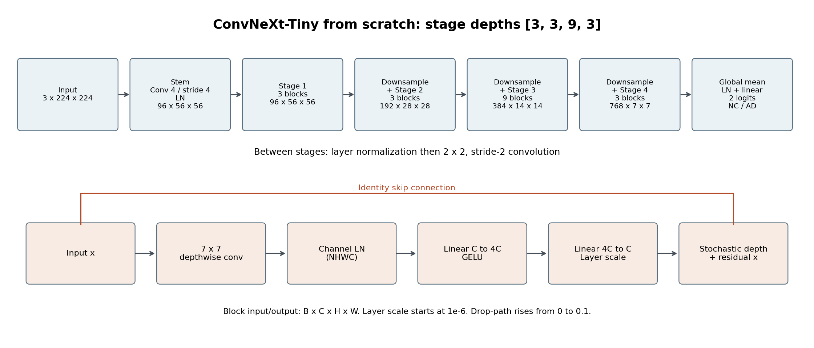
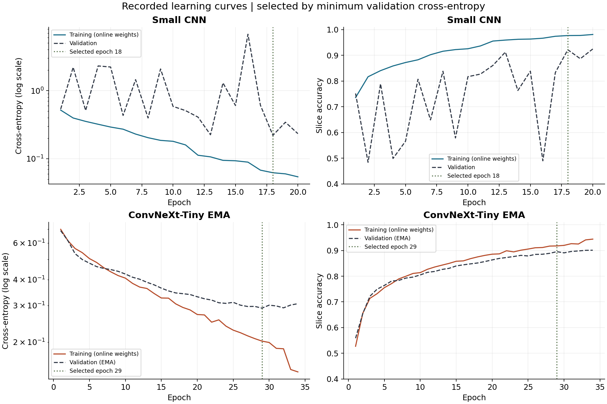
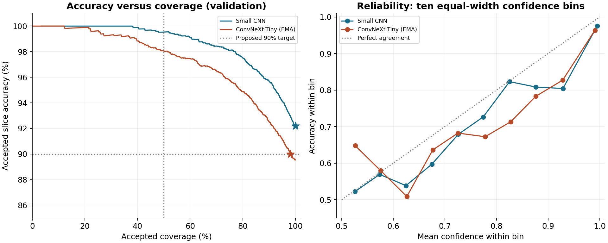
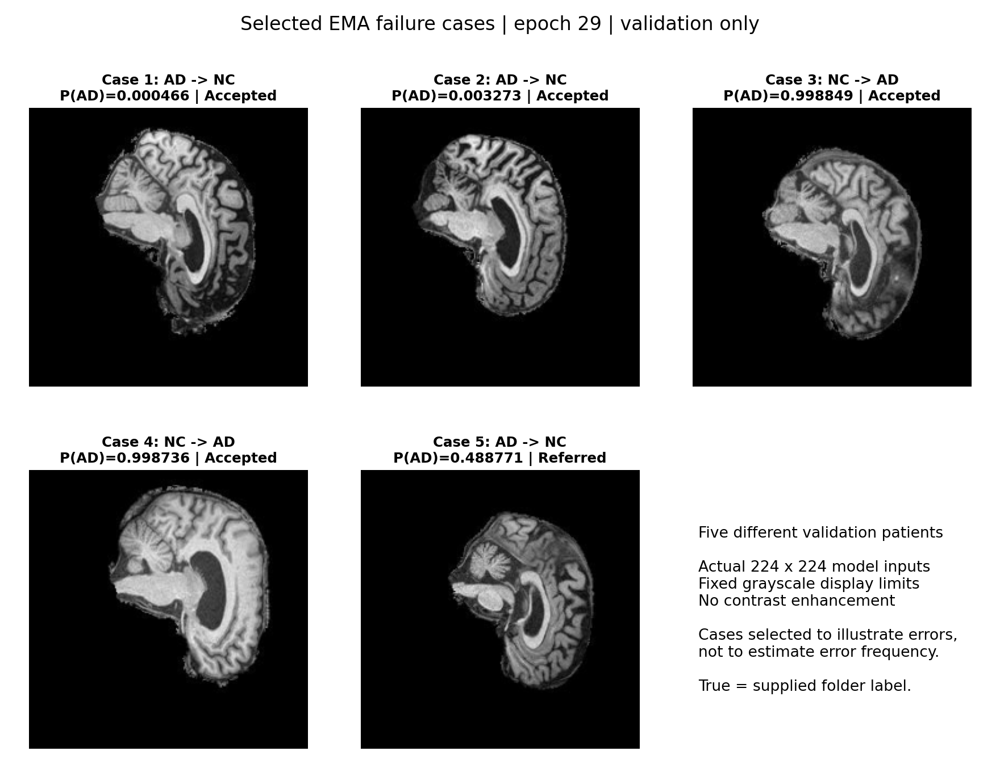

# ADNI MRI classification: ConvNeXt-Tiny versus a small CNN

**Weijie Peng | s4883545 | UQ COMP3710**

## Table of contents

1. [Overview](#1-overview)
2. [Feasibility review](#2-feasibility-review)
3. [Data, preprocessing and evaluation definitions](#3-data-preprocessing-and-evaluation-definitions)
4. [Architecture and training protocol](#4-architecture-and-training-protocol)
5. [Experiments and convergence](#5-experiments-and-convergence)
6. [Validation and test comparison](#6-validation-and-test-comparison)
7. [Confidence and human review](#7-confidence-and-human-review)
8. [Computational cost](#8-computational-cost)
9. [Failure cases and diagnostic experiments](#9-failure-cases-and-diagnostic-experiments)
10. [Engineering recommendation](#10-engineering-recommendation)
11. [Reproducibility and usage](#11-reproducibility-and-usage)

## 1. Overview

In this project, I investigate whether a modern convolutional classifier improves AD/NC recognition and confidence-based review enough to justify its computational cost. A custom PyTorch ConvNeXt-Tiny and a small CNN classify the supplied processed 2D ADNI MRI JPEG slices. Both start from random weights and use identical patient-disjoint splits. ConvNeXt applies depthwise spatial filtering, channel mixing and residual connections across four stages. I selected the ConvNeXt model using exponential moving average (EMA) weights based on validation loss.

**Final selected model:** my EMA ConvNeXt achieved **89.53% validation accuracy**, **74.40% slice-level test accuracy** and **77.33% patient-level test accuracy**. I selected epoch 29 using minimum validation loss. These test results are exploratory because earlier test evaluations informed subsequent experiments. The CNN achieved **92.19% validation and 71.31% slice-level test accuracy**. The required 80% slice-level test target remains **unmet**.



The supporting [measured evidence](report/results.json) and [figure provenance](report/ASSETS.md) are included in `report/`. I have excluded data, checkpoints, patient manifests and full prediction exports from Git.

## 2. Feasibility review
### User need and research question

I propose a research prototype that classifies ADNI MRI slices as Alzheimer's disease (AD) or normal control (NC) and flags uncertain cases for human review. I will investigate whether ConvNeXt improves classification and confidence reliability over a simple CNN enough to justify its computational cost. Imaging researchers are the intended users.

### Model choice and data configuration

I will implement ConvNeXt-Tiny with a two-class output and compare it with a small CNN, both trained from scratch. Convolutional features and residual connections apply the course's CNN concepts. JPEG slices in ADNI/AD\_NC will be resized to 224 by 224, with grayscale copied into three identical channels. I will randomly reserve approximately 20% of training patients for validation, stratified by AD/NC. The rest will train the model. The supplied test set will be held out for final evaluation. The training data will be normalised before training the models.

### Proposed acceptance criteria

1. Verify zero patient overlap between splits, resolve duplicates and patient IDs, and keep both classes in every split.  
2. Target at least 0.80 patient-level test accuracy. Compare both models on identical splits using per-class precision and recall, F1 and AUROC.  
3. Target at least 0.90 accuracy among accepted cases at 50% or greater coverage.  
4. Target peak training VRAM below 10 GiB on one GPU with at least 12 GiB available. Measure inference latency and parameter count for both models.  
5. Explain 3 to 5 false positives or false negatives, including confident errors, and recommend when human review remains necessary.

### Preliminary feasibility evidence

Through reviewing the dataset, there were 30,520 JPEGs. Training contains 10,400 AD and 11,120 NC. Testing contains 4,460 AD and 4,540 NC. All 10 sampled headers were 240 by 256 pixels (height by width). Two AD and two NC previews loaded with sample pixel values from 0 to 255\. Exact duplicates were not checked.

### Risks computing budget and next experiment

I propose a ceiling of 24 GPU-hours for baseline training, up to three ConvNeXt configurations and final evaluation, using mixed precision and early stopping. The ConvNeXt-Tiny model size is estimated at 28 million parameters. Peak VRAM is unmeasured. Risks include leakage, unknown patient counts and overfitting. Next, I will run a one-epoch baseline test on training-folder images to record loss, runtime and peak VRAM. For memory limits, I will reduce batch size. If accuracy or confidence targets fail, I will report the shortfall and recommend continued manual review.

## 3. Data, preprocessing and evaluation definitions

Teaching staff confirmed that `392586_92.jpeg` identifies patient `392586` and slice `92`. Volumes were already sliced and blank slices removed. Folder labels are **NC=0 and AD=1**. The task sheet's CN corresponds to the supplied NC folder.

The dataset remains at `ADNI/AD_NC` relative to the repository root, with `train/AD`, `train/NC`, `test/AD` and `test/NC`. [dataset.py](dataset.py) stratifies training patients by class with seed 42 and reserves approximately 20% for validation. All slices from one patient stay together. The original test folders are retained.

| Split | NC slices / patients | AD slices / patients | Total slices / patients |
|---|---:|---:|---:|
| Train | 8,900 / 445 | 8,320 / 416 | 17,220 / 861 |
| Validation | 2,220 / 111 | 2,080 / 104 | 4,300 / 215 |
| Test | 4,540 / 227 | 4,460 / 223 | 9,000 / 450 |

All 1,526 filename-derived patients have 20 slices. The completed audit found zero patient overlap, inconsistent patient labels, byte-identical duplicates or identical decoded-pixel duplicates within or across splits. Consistent folder labels are not independent clinical verification. The audit verified that both models used the same saved manifest SHA-256 hashes, included in [results.json](report/results.json).

Pillow converts each image to grayscale and bilinearly resizes it to **224 x 224**. Values are divided by 255 and copied into three identical channels. CNN uses [0,1] inputs. Selected ConvNeXt uses `2*x-1`, giving [-1,1]. ConvNeXt training alone uses rotation up to +/-7 degrees, translation up to 5% and scale 0.95-1.05, with bilinear interpolation and black fill, without flipping or shear. Validation, test and prediction use no random augmentation. These augmentations are experimental assumptions, not established anatomical invariances.

Each slice contributes one primary prediction. Predict AD if **P(AD)>0.5**, otherwise NC, including ties. Accuracy is the fraction correct, macro-F1 averages the two class F1 scores, and AD AUROC uses continuous **P(AD)** with AD positive. Precision and recall are reported separately for NC and AD. Cross-entropy is sample-weighted. Secondary patient metrics average P(AD) across that patient's slices after verifying consistent labels, then apply the same boundary. Patient scores and confidence-filtered scores do not replace unfiltered slice accuracy. [metrics.py](metrics.py) implements these definitions.

## 4. Architecture and training protocol

[modules.py](modules.py) implements the architecture in PyTorch/torchvision. The ConvNeXt block follows the [original paper](https://arxiv.org/abs/2201.03545) and [official model](https://github.com/facebookresearch/ConvNeXt/blob/main/models/convnext.py): 7 x 7 depthwise convolution, channels-last layer normalization, fourfold linear expansion, GELU, projection, layer scale and a residual branch with stochastic depth. Local adaptations are the two-class head, native PyTorch layer normalization and torchvision stochastic depth instead of timm. Attribution and the [MIT notice](LICENSE-ConvNeXt.txt) are retained.

| Component | Output, excluding batch dimension | Blocks |
|---|---|---:|
| Stem: 4 x 4 convolution, stride 4, normalization | 96 x 56 x 56 | - |
| Stage 1 | 96 x 56 x 56 | 3 |
| Downsample + stage 2 | 192 x 28 x 28 | 3 |
| Downsample + stage 3 | 384 x 14 x 14 | 9 |
| Downsample + stage 4 | 768 x 7 x 7 | 3 |
| Global average pooling, final normalization, head | 2 logits | - |

Separate normalization-plus-convolution downsamplers halve spatial dimensions and double channels. Layer scale starts at 1e-6, normalization epsilon is 1e-6, and stochastic-depth probability increases from 0 to 0.1. Convolutional/linear weights use truncated-normal initialization with standard deviation 0.02. No pretrained weights are fetched.

The CNN has three 3 x 3 convolution blocks with 16, 32 and 64 channels, each followed by batch normalization, ReLU and max pooling. A 64 x 4 x 4 pooled representation feeds a 128-unit ReLU classifier, dropout 0.2 and two logits.

**Checkpoint selection:** I used minimum validation slice cross-entropy, keeping the earliest epoch on an exact tie. I set this rule before comparing the models. Accuracy does not override this rule. Both families use the same trainer, split manifests and metric code.

| Setting | CNN | Selected ConvNeXt EMA |
|---|---|---|
| Optimizer / initial LR | AdamW / 0.001 | AdamW / 0.0001 |
| Betas / epsilon | (0.9, 0.999) / 1e-8 | Same |
| Weight decay | 0.0001, all parameters | 0.01 on multidimensional weights, zero on biases and 1D parameters |
| Batch / CUDA precision | 32 / FP16 with GradScaler | 16 / BF16 without GradScaler |
| Scaling / augmentation | [0,1] / none | [-1,1] / mild affine |
| Other regularization | Classifier dropout 0.2 | Stochastic depth up to 0.1 |
| Gradient clipping / label smoothing | Norm 5 / 0 | Same |
| EMA | None | Decay 0.999, FP32 shadow weights, successful optimizer updates only |
| Scheduler | ReduceLROnPlateau on validation loss | Same, using EMA validation loss |
| Scheduler settings | Factor 0.5, patience 2, absolute threshold 0, minimum LR 1e-6 | Same |
| Early stopping | Patience 5, minimum improvement 0 | Same |
| Epoch budget / completed / selected | 20 / 20 / 18 | 40 / 34 / 29 |
| Seed / workers / CPU threads | 42 / 0 / 4 | Same |

Bias/1D exclusions follow the [official optimizer grouping](https://github.com/facebookresearch/ConvNeXt/blob/main/optim_factory.py). EMA follows the update-after-optimizer pattern in the [official engine](https://github.com/facebookresearch/ConvNeXt/blob/main/engine.py), with a local successful-update check and fixed decay. EMA weights drive validation, scheduling, stopping and prediction. Best/last checkpoints preserve model settings, preprocessing, class mapping, optimizer, scheduler, epoch and random state. These choices differ between pipelines, so this is not an architecture-only ablation.

## 5. Experiments and convergence

The table summarises the experiments included in this report. I report outcomes at the checkpoint selected by validation loss. The hypotheses describe my reasons for trying each strategy. Comparisons use one seed, different stopping epochs and some continued training lineages, which limits causal claims. A dash means that checkpoint was not evaluated on test.

| Strategy and hypothesis | Changed setting | Selected epoch / completed | Validation accuracy / loss | Test accuracy |
|---|---|---:|---:|---:|
| CNN: establish a low-cost reference | Three convolution blocks, LR 1e-3, FP16 | 18 / 20 | 92.19% / 0.220289 | 71.31%, frozen |
| BF16: avoid FP16 overflows | BF16, LR 3e-4, unit inputs, no augmentation | 5 / 10 | 52.09% / 0.689988 | - |
| Centering: improve optimization | Scale [0,1] to [-1,1] | 2 / 7 | 70.53% / 0.659615 | - |
| Lower LR: stabilize updates | 3e-4 to 3e-5 | 2 / 7 | 73.79% / 0.525159 | - |
| Affine: improve generalization | Add mild affine transforms | 20 / 20 | 79.00% / 0.438211 | - |
| More epochs: extend a progressing run | Continue affine lineage to 30 | 29 / 30 | 80.12% / 0.427508 | 70.72%, frozen |
| Further continuation: reduce remaining loss | Continue toward 40 after test exposure | 34 / 39 | 80.42% / 0.413108 | - |
| Intermediate LR: balance progress/stability | Fresh affine run at 1e-4 | 24 / 29 | 85.79% / 0.338677 | 72.10%, exploratory |
| Grouped decay: avoid shrinking biases/1D parameters | Decay 0.01 for multidimensional weights, otherwise zero | 21 / 26 | 86.81% / 0.318166 | 73.33%, exploratory |
| EMA: smooth noisy weight updates | Fixed decay 0.999 with grouped decay | 29 / 34 | **89.53% / 0.291337** | **74.40%, exploratory** |
| Warmup/cosine: improve LR trajectory | Three warmup epochs, start factor 0.01, 40-epoch cosine horizon | 19 / 24 | 85.63% / 0.343083 | 72.17%, exploratory |

An earlier one-epoch FP16 ConvNeXt trial skipped 33 of 1,077 attempted optimizer updates and was excluded from quality comparison. The BF16 lineage recorded zero skipped updates. Grouped decay improved selected validation loss over the all-decay LR 1e-4 control. EMA improved it further. Warmup/cosine performed worse than its control. Cosine stopped before completing its planned decay horizon. I therefore retained EMA based on validation evidence. These comparisons do not establish that each observed difference isolates one causal factor.



CNN training loss fell from 0.5169 to 0.0541, but validation was unstable: epoch 16 reached loss 6.7379 and accuracy 49.00% before recovery. Epoch 18 minimizes loss. Epoch 20's 92.49% accuracy does not override its higher 0.233174 loss. EMA validation loss fell from 0.687097 to 0.291337 at epoch 29. Epochs 30-34 did not improve it, triggering early stopping. Epoch 34 reached 90.09% validation accuracy while online training accuracy reached 94.41%. This indicates diminishing validation-loss gains, not evidence that more epochs would improve unseen patients. Training curves use changing online weights and regularization, while EMA validation uses averaged weights. Both loss panels use a logarithmic axis to retain the CNN spike.

## 6. Validation and test comparison

The current comparison uses identical **4,300 validation slices from 215 patients** and **9,000 test slices from 450 patients**. All slices are included, without confidence filtering. EMA is my final selected ConvNeXt model for this submission. CNN test results reuse its original frozen evaluation. EMA test results are later exploratory measurements.

| Metric | CNN validation | EMA validation | CNN test, original frozen | EMA test, exploratory |
|---|---:|---:|---:|---:|
| Accuracy | 92.19% | 89.53% | 71.31% | 74.40% |
| Cross-entropy | 0.220289 | 0.291337 | 2.096713 | 0.979386 |
| Macro-F1 | 0.921831 | 0.895348 | 0.701971 | 0.738579 |
| AD AUROC | 0.977354 | 0.958063 | 0.785493 | 0.824349 |
| NC precision | 93.53% | 92.79% | 65.79% | 69.42% |
| NC recall | 91.17% | 86.44% | 89.85% | 88.02% |
| AD precision | 90.82% | 86.51% | 83.54% | 83.23% |
| AD recall | 93.27% | 92.84% | 52.44% | **60.54%** |

For historical comparison, the original freeze occurred on **25 October 2026**, before test inference. That pair was CNN epoch 18 and the earlier non-EMA ConvNeXt epoch 29 from the LR 3e-5 affine lineage. Their test accuracies remain **71.31% and 70.72%**, respectively. The original ConvNeXt's macro-F1 was 0.703283 and AD AUROC 0.784545. This earlier ConvNeXt is not my final selected model. Its checkpoint is distinct from EMA even though both selected epochs are numbered 29.

I used later test results to guide further experiments. Selecting each checkpoint by validation loss does not remove the bias introduced by this broader test-guided search. The 74.40% EMA result is descriptive exploratory evidence, not a newly frozen final estimate. Neither model meets 80%. No significance claim is made for their 3.09-point test difference, and correlated slices are not independent samples.

Test confusion matrices, with true rows and predicted columns in [NC, AD] order, are CNN `[[4079,461],[2121,2339]]` and EMA `[[3996,544],[1760,2700]]`. EMA therefore misses **1,760 of 4,460 AD-labelled slices**. These are slice errors, not counts of missed patient diagnoses. Secondary patient-mean accuracy is CNN/EMA **95.81%/93.95% on validation** and **71.33%/77.33% on test**, with the same evaluation-history limitations. Patient aggregation cannot satisfy the primary slice target.

## 7. Confidence and human review

Confidence is `max(P(AD), 1-P(AD))`, not a calibrated probability of correctness. Using validation data only, I selected the lowest threshold achieving maximum coverage subject to at least 90% accepted accuracy and 50% coverage. Predictions at or above the threshold are accepted, keeping all ties. No temperature scaling or other calibration was fitted.

| Validation statistic | CNN | EMA |
|---|---:|---:|
| Selected threshold | 0.5 | **0.5549529194831848** |
| Coverage | 100.00% | 98.16% |
| Accepted accuracy | 92.1860% | 90.0024% |
| Accepted / referred slices | 4,300 / 0 | 4,221 / 79 |
| Errors accepted / referred | 336 / 0 | 422 / 28 |
| Mean confidence on wrong predictions | 78.68% | 81.60% |
| Correctness AUROC | 0.884403 | 0.829978 |
| Binary Brier score | 0.059112 | 0.082394 |
| ECE, ten confidence bins | 0.028103 | 0.044942 |



Correctness AUROC treats correctness as positive and confidence as the score, distinct from AD AUROC. Brier is mean `(P(AD)-label)^2`. ECE uses ten equal-width bins over [0.5,1]. CNN has better validation confidence ranking and lower Brier/ECE. EMA refers only **6.22% of its 450 errors**, retaining 139 AD false negatives. Its referred group also includes 51 correct predictions. CNN accepts everything because it already exceeds the stated 90% objective, which is not evidence that all its predictions are reliable.

At confidence at least 0.95, EMA still makes 112 validation errors across 37 patients, including 39 AD false negatives. CNN makes 85 errors across 19 patients. At threshold 0.95, EMA's accepted accuracy is 96.34% at 71.26% coverage. At 0.99 it reaches 98.07%, but coverage falls below the proposed minimum to 49.35%. The selected EMA policy's patient-bootstrap 95% interval for accepted accuracy is 87.52%-92.27%, from 2,000 replicates with seed 42. This descriptive interval does not correct for selecting the model and threshold on the same patients.

The exact [review policy](report/review_policy.json) is bound to checkpoint and split hashes. It was selected using validation data after earlier test exposure and has **not been evaluated on test for EMA**. It is a reproducible research operating point, not a guarantee. Additional disagreement/context policies below remain exploratory and have not replaced it.

## 8. Computational cost

Measured on an NVIDIA GeForce RTX 4070. Parameter counts include all trainable parameters. VRAM is peak PyTorch allocated/reserved memory during complete training steps, not total GPU use. Training-process time includes recorded run segments but excludes prior experiments, idle time and separate evaluation.

| Measurement | CNN | Selected EMA ConvNeXt |
|---|---:|---:|
| Total / trainable parameters | 155,154 / 155,154 | 27,821,666 / 27,821,666 |
| Peak allocated / reserved training VRAM | 0.380 / 0.537 GiB | 1.474 / 1.656 GiB |
| Recorded training-process runtime | 19.59 min | 50.88 min |
| Training batch / precision | 32 / FP16 | 16 / BF16 |
| Batch-one GPU forward median / p95 | 1.408 / 2.564 ms | 14.893 / 21.653 ms |
| Batch-one JPEG pipeline median / p95 | 4.425 / 5.352 ms | **18.506 / 25.922 ms** |
| Batch-16 JPEG pipeline throughput | 450.9 images/s | 327.0 images/s |

Latency was measured on **28 October with the selected EMA checkpoint and the CNN in the same session**. The same 128 validation slices from 95 patients were used, with three repeats of 20 warm-up and 100 timed batches per setting. Synchronization brackets each timing interval, following [PyTorch guidance](https://docs.pytorch.org/docs/2.9/notes/cuda.html#asynchronous-execution). Models use evaluation/inference mode, contiguous tensors, deterministic algorithms, no TF32 and no compilation.

The JPEG pipeline includes file reads and hash checks, decoding, preprocessing, batching, transfer, forward inference, softmax and returned CPU probabilities. It excludes startup, checkpoint loading, plots and metrics. Reads are warmed, and background desktop activity was present. These are session measurements, not cold-disk or service guarantees. p95 is an empirical percentile. Batch throughput is total images divided by total timed seconds, not the reciprocal of median time. Batch-16 amortized time is not single-image response latency.

EMA's median batch-one pipeline is **4.18 times** CNN's at the recorded precisions. Common FP32 timings are 11.981 ms for EMA and 3.422 ms for CNN. FP32 was faster than BF16 for EMA at batch one, while BF16 was faster at batch 16. This comparison did not change evaluation precision or thresholds. EMA averaging adds no inference operation because its weights are already stored. The earlier non-EMA benchmark remains historical evidence and is not substituted for these measurements. Four latency tests and independent checks of 4,800 timing samples passed.

## 9. Failure cases and diagnostic experiments

I selected cases from five different validation patients: the two most confident false negatives from distinct patients, two most confident false positives, and the least-confident referred false negative from a fifth patient. They deliberately illustrate failure modes and are not a representative frequency estimate. Case numbers replace source identifiers in the published figure. True labels are supplied folder labels, not diagnoses inferred from the pictures.



| Case | True to predicted | P(AD) | Confidence | Review | CNN prediction |
|---|---|---:|---:|---|---|
| 1 | AD to NC | 0.000466 | 99.9534% | Accept | AD |
| 2 | AD to NC | 0.003273 | 99.6727% | Accept | NC |
| 3 | NC to AD | 0.998849 | 99.8849% | Accept | NC |
| 4 | NC to AD | 0.998736 | 99.8736% | Accept | NC |
| 5 | AD to NC | 0.488771 | 51.1229% | Refer | AD |

**Case 1: persistent confident false negative.** Visible evidence is a broad black surround, a bright curved internal band and folded edges. Exactly 70.43% of source pixels are zero, which is not a brain-mask measurement. **Possible reasons:** different learned class associations are supported by strong model disagreement, with CNN P(AD)=0.999845 versus EMA 0.000466. Slice dependence is plausible because EMA is wrong on 13/20 slices, but averaging the other 19 only raises P(AD) to 0.381163, still wrong. Tested intensity/geometry changes do not correct it. Sigma-1 blur gives 0.007577 and FP32 0.000457, weakening a simple rounding explanation. **Mitigation:** review model disagreements and patient-wide errors rather than relying on confidence alone. The experiments do not identify an anatomical cause.

**Case 2: shared false negative with detail sensitivity.** The image has visible folds and a bright curved internal region against dark surroundings. **Possible reasons:** both models may lack transferable evidence for this patient, with CNN P(AD)=0.031173 and EMA 0.003273. EMA misses 13/20 slices and CNN 18/20. Sigma-1 blur raises EMA P(AD) to 0.402040, showing detail sensitivity without correcting the class. Neighbour averaging gives 0.019378 and the other-19 mean 0.349972, so context alone also fails. Original-image FP32 retains the error. **Mitigation:** audit confident agreement and patient groups as well as model disagreement. Examine acquisition metadata or controlled training changes in future work. Blur is not an adopted correction and cannot reveal whether useful anatomy or incidental texture drives the score.

**Case 3: slice error resolved by broader context.** Visible evidence includes a bright internal arc, dark internal spaces and an irregular folded outline. **Possible reasons:** isolated-slice evidence is supported by EMA's nine errors among this patient's 20 slices. The neighbour mean remains wrong at P(AD)=0.742835, but the other-19 mean is 0.451924, correctly NC. CNN correctly classifies all 20 slices. Sigma-1 blur lowers P(AD) to 0.899475 but leaves the error, and original-image FP32 keeps the AD decision. **Mitigation:** flag slice/patient or model disagreement for investigation. Context helps this case but is a different prediction unit and cannot replace the primary slice result.

**Case 4: confident false positive persisting across the patient.** The displayed slice contains bright folded regions and darker internal spaces surrounded by black pixels. **Possible reasons:** a model-specific association is supported by EMA's 12/20 wrong slices versus CNN's five. Averaging the other 19 slices still gives EMA P(AD)=0.644095, while CNN gives 0.348224. Sigma-1 blur gives 0.996727, and original-image FP32 gives 0.998696. The tested variants preserve the error and keep confidence above the review threshold. Overconfidence explains why review misses the error, not why the classifier learned that association. **Mitigation:** review model disagreements and patient-wide patterns. Neither simple patient averaging nor confidence-only referral solves this case.

**Case 5: unstable boundary decision caught by referral.** The visible cross-section occupies a smaller area, with a broad black surround, a narrow internal bright curve and a darker upper-right region. Source zero-pixel fraction is 75.90%. **Possible reasons:** intensity sensitivity is demonstrated by P(AD)=0.824744 after brightness x0.9 and 0.306527 after x1.1. Four-pixel left/right shifts give 0.224735/0.826151. Aspect-preserving resizing gives 0.882428, but reduces full-validation EMA accuracy to 89.02%, so fixing one case does not justify changing preprocessing. The neighbour and other-19 means, 0.569246 and 0.850410, both correct this sole EMA error among the patient's 20 slices. FP32 remains wrong at 0.487798. **Mitigation:** retain referral and inspect context or stability. Do not select per-image transforms using the known label.

The supporting experiments used all **4,300 validation slices**, without retraining or test inference. Brightness/contrast +/-10%, gamma 0.9/1.1, four-pixel shifts and crop/rescale corrected case 5 under six of eleven changes, but never corrected the four confident cases. Additional blur, resampling and aspect controls left those four wrong. CNN was especially sensitive: sigma-1 blur reduced validation accuracy to 48.26%, versus EMA's 88.33%. This supports preprocessing sensitivity, not a proven anatomical explanation.

EMA neighbour-context accuracy was 91.02%, and excluding the target and averaging the other 19 patient slices gave 93.93%. These are secondary context-dependent scores. An exploratory rule referring low confidence **or** model disagreement **or** slice/patient disagreement referred 679 slices, including 379/450 errors, leaving 98.04% accepted accuracy at 84.21% coverage. It also referred 300 correct slices and incurs additional inference/context costs. No new rule was adopted, and neither these findings nor visible images establish atrophy, a scanner cause or incorrect clinical labels.

## 10. Engineering recommendation

**I selected EMA as my final ConvNeXt model, but its current benefit does not justify replacing the CNN as the default low-cost experimental baseline. Neither model supports autonomous diagnosis.** EMA's exploratory test advantage is 3.09 percentage points, with higher macro-F1 and AD AUROC. It also resisted several preprocessing changes better than CNN. However, it has lower validation accuracy and weaker confidence routing, approximately 179 times as many parameters, 2.60 times the recorded training-process time and 4.18 times the measured single-image pipeline latency.

The validation-to-test gaps are **15.13 points for EMA and 20.87 for CNN**. Patient separation and exact-duplicate checks passed, but do not prove equivalent distributions. Repeated validation adaptation, limited independent patient diversity and unobserved acquisition/appearance differences are possible contributors. Sensitivity experiments support some input dependence, without establishing a single cause. CNN's own strong blur/resampling sensitivity prevents treating its low cost as evidence of universal superiority.

EMA remains **5.60 points below 80%**, and **60.54% test AD recall** means 39.46% of AD-labelled slices are missed. High AUROC and accepted-case accuracy do not compensate for this operating-point weakness. The selected confidence threshold retains most errors and misses confident false negatives. Lowering the AD decision boundary could trade false positives for recall, but must be developed using validation rather than chosen from test mistakes.

My recommendation is to preserve the current checkpoints, preprocessing and review policy, report the shortfall, and stop using this exposed test set to guide changes. For further work, I would freeze candidates and evaluate untouched patients, ideally across independent acquisition conditions, with patient-level uncertainty estimates and workload-specific latency. Calibration, an AD-recall-oriented decision rule and disagreement/context review are candidates for that study. Repeated test exposure cannot be repaired by another run on the same test set. The complexity is justified for this architectural investigation, not yet as an established deployment improvement.

## 11. Reproducibility and usage

The required entry points are [modules.py](modules.py), [dataset.py](dataset.py), [train.py](train.py) and [predict.py](predict.py). Helper scripts provide metrics, training state, curves, comparison, confidence, diagnostics and latency. No model download is embedded in the code.

Recorded environment: Windows 11, Python **3.13.3**, PyTorch **2.9.0+cu126**, torchvision **0.24.0+cu126**, Pillow **11.3.0**, NumPy **2.3.3**, scikit-learn **1.8.0**, Matplotlib **3.10.6**, CUDA runtime **12.6** and RTX 4070. Run all commands below from the **repository root**. Matching [PyTorch installation commands](https://pytorch.org/get-started/previous-versions/) are:

```powershell
py -3.13 -m pip install torch==2.9.0 torchvision==0.24.0 --index-url https://download.pytorch.org/whl/cu126
py -3.13 -m pip install Pillow==11.3.0 numpy==2.3.3 scikit-learn==1.8.0 matplotlib==3.10.6
$p = 'recognition/ConvNeXt_ADNI_s4883545'
py -3.13 "$p/train.py" --check-environment
py -3.13 "$p/train.py" --help
py -3.13 "$p/predict.py" --help
```

Obtain the processed ADNI data through authorized course access and place it at `ADNI/AD_NC`. Cloning this repository supplies neither data nor trained weights. Create the audited manifests once, using a fresh directory:

```powershell
py -3.13 "$p/dataset.py" --data-root ADNI/AD_NC --seed 42 --val-fraction 0.2 --output "$p/artifacts/splits_seed42"
```

If those saved manifests already exist, reuse them. Do not overwrite the experiment splits. Their audit rechecks identities and hashes when loaded.

Fresh training commands, with output names distinct from the recorded runs:

```powershell
$cnn = "$p/artifacts/runs/cnn_reproduction"
$ema = "$p/artifacts/runs/ema_reproduction"

py -3.13 "$p/train.py" --model small_cnn --data-root ADNI/AD_NC --splits "$p/artifacts/splits_seed42" --epochs 20 --batch-size 32 --lr 0.001 --weight-decay 0.0001 --input-scaling unit --train-augmentation none --seed 42 --device cuda --workers 0 --threads 4 --amp --amp-dtype float16 --patience 5 --min-delta 0 --lr-patience 2 --lr-factor 0.5 --output $cnn

py -3.13 "$p/train.py" --model convnext_tiny --data-root ADNI/AD_NC --splits "$p/artifacts/splits_seed42" --epochs 40 --batch-size 16 --lr 0.0001 --weight-decay 0.01 --weight-decay-policy exclude_1d_bias --ema --ema-decay 0.999 --drop-path-rate 0.1 --input-scaling centered --train-augmentation mild_affine --seed 42 --device cuda --workers 0 --threads 4 --amp --amp-dtype bfloat16 --lr-schedule plateau --patience 5 --min-delta 0 --lr-patience 2 --lr-factor 0.5 --output $ema
```

The recorded CNN lineage included a three-epoch trial, a one-epoch resume check and continuation to epoch 20. A fresh command reproduces its configuration, not a claim of bit-identical execution history. Different hardware/libraries can also change results. Saved `best.pt` and `last.pt` contain evaluation and resumable state. Resume uses `--resume <run>/last.pt` with the same training settings and a fresh output directory. `--epochs` is the total target, not additional epochs. Completed epoch history is in `history.json`, with `config.json`, `status.json` and `training.log` for settings and progress.

Evaluate the reloaded checkpoints on validation, produce curves and select a new confidence policy for these new weights:

```powershell
py -3.13 "$p/train.py" --mode evaluate --model small_cnn --checkpoint "$cnn/best.pt" --data-root ADNI/AD_NC --splits "$p/artifacts/splits_seed42" --eval-split val --batch-size 32 --device cuda --workers 0 --save-predictions --output "${cnn}_validation"
py -3.13 "$p/train.py" --mode evaluate --model convnext_tiny --checkpoint "$ema/best.pt" --data-root ADNI/AD_NC --splits "$p/artifacts/splits_seed42" --eval-split val --batch-size 16 --device cuda --workers 0 --save-predictions --output "${ema}_validation"
py -3.13 "$p/report_run.py" --run $cnn --validation "${cnn}_validation/evaluation.json"
py -3.13 "$p/report_run.py" --run $ema --validation "${ema}_validation/evaluation.json"
py -3.13 "$p/compare_validation.py" --cnn-run $cnn --convnext-run $ema --splits "$p/artifacts/splits_seed42" --output "$p/artifacts/comparison_reproduction"
py -3.13 "$p/analyze_confidence.py" --cnn-run $cnn --convnext-run $ema --splits "$p/artifacts/splits_seed42" --experiment-status after_test_exposure --output "$p/artifacts/confidence_reproduction"
```

The existing test set remains exposed even for these new runs. To explicitly reproduce test inference after fixing a configuration, change `--eval-split val` to `--eval-split test` and choose a fresh output directory. Such results remain exploratory. No test inference was executed when preparing this report.

The following demonstration uses my retained selected checkpoint. The exact original file must be available at the indicated path. Otherwise train above and substitute the new checkpoint, omitting the old review policy or using its newly selected replacement.

```powershell
$best = "$p/artifacts/runs/convnext_ema0999_grouped_wd_20261026/best.pt"
py -3.13 "$p/predict.py" --checkpoint $best --data-root ADNI/AD_NC --splits "$p/artifacts/splits_seed42" --limit 12 --device cuda --review-policy "$p/report/review_policy.json" --output "$p/artifacts/prediction_demo_reproduction"

# Replace this path with an image to predict individually
py -3.13 "$p/predict.py" --checkpoint $best --images path/to/image.jpeg --device cpu --output "$p/artifacts/single_image_reproduction"

py -3.13 "$p/benchmark_latency.py" --cnn-run $cnn --convnext-run $ema --splits "$p/artifacts/splits_seed42" --data-root ADNI/AD_NC --output "$p/artifacts/latency_reproduction"
py -3.13 -m unittest discover -s $p -p 'test_*.py'
```

Prediction restores architecture, EMA identity, preprocessing and CUDA precision. CPU uses FP32, which can slightly change probabilities. Outputs are `predictions.csv`, `prediction.json` and `demo.png`. Individual images have unknown ground truth, with no labels inferred from folders. `--limit` selects evenly spaced manifest positions and labels metrics as a demonstration subset. Omit it for complete validation metrics. A full audited split additionally reports patient aggregation. Review policies must match checkpoint and split hashes. All output directories must be fresh.

The selected EMA checkpoint SHA-256 is `c1e792929e2cc7511489fa7807c96c8e895a80645c1aa273f52f44e42c0096f3`. CNN's is `722924cedcdd6afb053ed7967d04e1688e601b9f74909d6305d6af382e654fe5`. Compact evidence preserves identities, full-precision metrics, histories, confidence statistics and latency summaries. It permits inspection of report claims without private files, but cannot replace those files for rerunning inference.

Verification completed during development includes patient/duplicate audits, known-label metric calculations, shape and finite-gradient checks, an optimizer update, checkpoint reloads and resumed training. The prediction milestone passed 35 targeted tests and reproduced every saved P(AD) value for both models on all 4,300 validation slices. The single-image CPU demonstration also ran. Latency's four tests and timing recomputation passed. These checks were completed during development. The entire test suite was not rerun during report preparation.